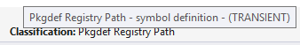

# Extensibility Margin

[](https://github.com/madskristensen/ExtensibilityMargin/actions/workflows/build.yaml)
[](https://github.com/sponsors/madskristensen)

A focused utility for Visual Studio extension authors.

Extensibility Margin adds live diagnostics to the editor status row so you can inspect editor state at the caret without writing temporary debug UI.

Download this extension from the [Marketplace](https://marketplace.visualstudio.com/items?itemName=MadsKristensen.ExtensibilityMargin)
or get the [CI build](https://www.vsixgallery.com/extension/41b4c077-6d9f-4e0a-a356-988baf3e830a).

-----------------------------------------
  
The margin sits immediately to the left of Visual Studio's built-in line/column information in the editor status row and is designed for people building editor features.

## Why extension authors use it

- Validate `ITextBuffer` content types in real time
- Inspect classification names and inheritance while testing classifiers
- Inspect text view roles when troubleshooting MEF provider activation

If you work with MEF editor components, taggers, classifiers, or command handlers, this gives immediate feedback directly in the editor.

## Toggle on/off

Toggle the margin visibility on/off from a new button on the Standard toolbar.


## Editor status margin

Shows content type, classification, and text view roles alongside Visual Studio's built-in editor information. Encoding and selection information are provided by Visual Studio itself.

### Content type

Shows the content type of the ITextBuffer at the caret position. The hover tooltip shows the name of the base content type.

Useful when troubleshooting content type mismatches in providers and listeners.

### Classification

Displays the name of the classification at the caret position in the document. The hover tooltip shows the inheritance hierarchy of the EditorFormatDefinition's BaseDefinition attribute.



### Roles

Shows a text view role. Hover to see all roles supported by the current view.

## Typical workflows

1. Move the caret through sample text while validating content type/classification behavior.
2. Hover margin items to inspect additional metadata.
3. Toggle the margin on/off from the Standard toolbar when not needed.

## Installation

Install from the [Marketplace](https://marketplace.visualstudio.com/items?itemName=MadsKristensen.ExtensibilityMargin) or use the latest [CI build](https://www.vsixgallery.com/extension/41b4c077-6d9f-4e0a-a356-988baf3e830a).

## License

[Apache 2.0](LICENSE)

## Building and debugging

Open `ExtensibilityMargin.slnx` in Visual Studio 2022 17.14 or newer with the **Visual Studio extension development** workload and the .NET Framework 4.8 targeting pack installed. The SDK-style VSIX project also requires the .NET 9 SDK or newer.

Select **Debug / Any CPU** and press **F5** or **Ctrl+F5** to deploy and launch the extension in the experimental instance. Enable the **Standard** toolbar to find **Toggle Extensibility Margin**.

For a release build, run these commands from a Visual Studio Developer PowerShell:

```powershell
msbuild ExtensibilityMargin.slnx /t:Restore /p:Configuration=Release
msbuild ExtensibilityMargin.slnx /m /p:Configuration=Release /p:DeployExtension=false
```

The VSIX is written to `src\bin\Release\net48\ExtensibilityMargin.vsix`. CI builds pull requests and publishes push/manual builds to Open VSIX; Marketplace publishing and GitHub releases require a `[release]` commit message or a manual run.
