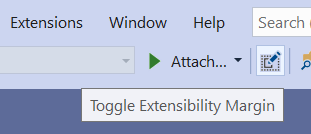
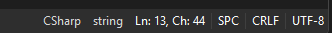

# Extensibility Margin

A focused utility for Visual Studio extension authors.

Extensibility Margin adds live diagnostics to the editor status row so you can inspect editor state at the caret without writing temporary debug UI.

Download this extension from the [Marketplace](https://marketplace.visualstudio.com/items?itemName=MadsKristensen.ExtensibilityMargin)
or get the [CI build](https://www.vsixgallery.com/extension/41b4c077-6d9f-4e0a-a356-988baf3e830a).

-----------------------------------------
  
The margin sits immediately to the left of Visual Studio's built-in line/column information in the editor status row and is designed for people building editor features.

## Why extension authors use it

- Validate `ITextBuffer` content types in real time
- Inspect classification names and inheritance while testing classifiers
- Inspect text view roles when troubleshooting MEF provider activation

If you work with MEF editor components, taggers, classifiers, or command handlers, this gives immediate feedback directly in the editor.

## Toggle on/off

Toggle the margin visibility on/off using **Toggle Extensibility Margin** on the Standard toolbar. Your choice is remembered across Visual Studio sessions. New profiles start with the margin hidden.

## Editor status margin

Shows two compact, regular-weight values: content type and classification. Long names are shortened visually with an ellipsis; hover to see the full details. Text view roles are included in the content-type tooltip instead of taking up space in the row. Encoding and selection information are provided by Visual Studio itself.

### Content type

Shows the content type of the source buffer at the caret position, including in projection editors. The tooltip groups unique base types and text view roles into explained sections. View and document types appear only when they differ from the type at the caret. Click to copy the full inheritance details.

Useful when troubleshooting content type mismatches in providers and listeners.

### Classification

Displays the primary classification at the caret. Hover to see all overlapping classification types returned by the editor and their full inheritance hierarchies. `None` means no classification is available at that position.

### Copy diagnostics

Click either value to copy content types, text view roles, and classification details to the clipboard. The report contains no document text or file paths.

### Lightweight updates

Caret and classification updates are coalesced, and classification changes away from the caret are ignored. Classifier services are initialized only when needed and released while the margin or editor tab is hidden. Projection-buffer and content-type changes invalidate cached diagnostics.

## Typical workflows

1. Move the caret through sample text while validating content type/classification behavior.
2. Hover margin items to inspect additional metadata.
3. Click either value to copy diagnostics into a bug report.
4. Toggle the margin on/off from the Standard toolbar when not needed.

## Installation

Install from the [Marketplace](https://marketplace.visualstudio.com/items?itemName=MadsKristensen.ExtensibilityMargin) or use the latest [CI build](https://www.vsixgallery.com/extension/41b4c077-6d9f-4e0a-a356-988baf3e830a).

## License

[Apache 2.0](LICENSE)
